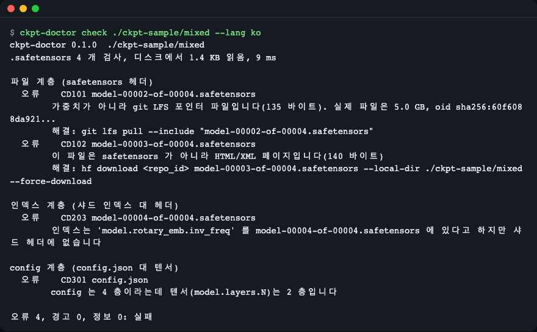
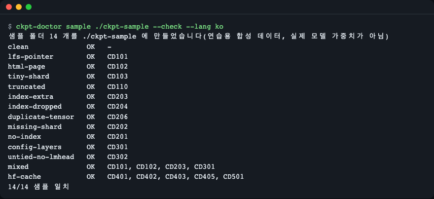
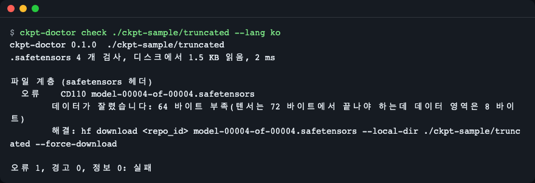
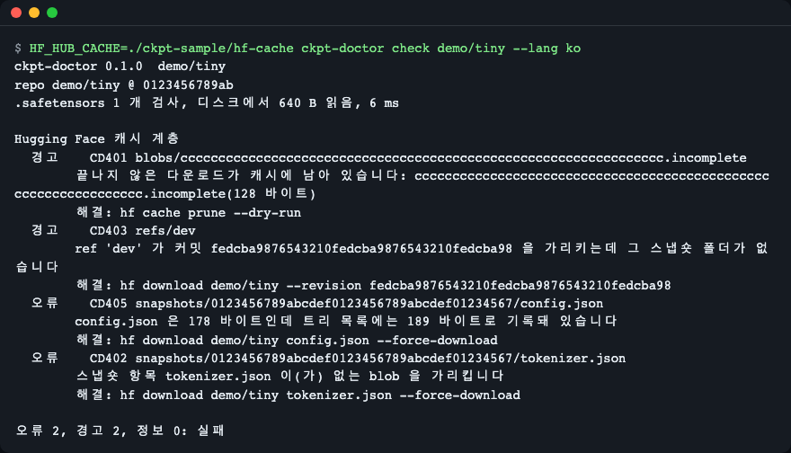
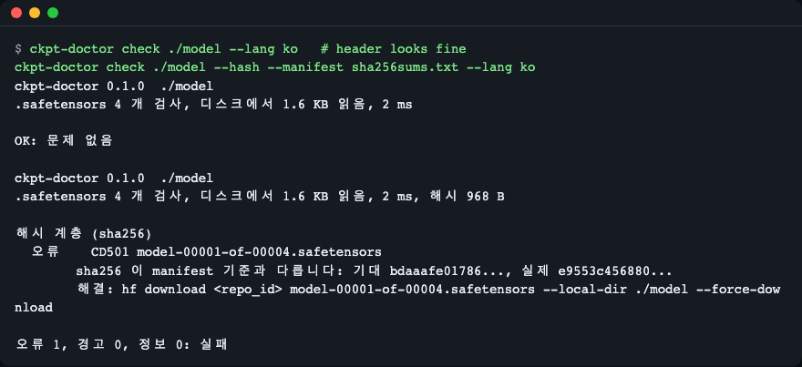
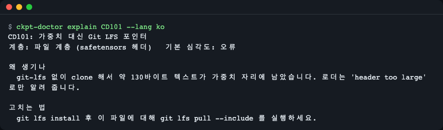
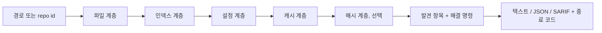

# ckpt-doctor

[English](README.md) | **한국어**

모델 폴더의 어느 `.safetensors` 파일이 왜 깨졌는지, 그리고 고치는 명령까지 알려 줍니다. 각 파일의 앞부분 몇 KB만 읽으므로 torch도, `safetensors` 패키지도, 네트워크도 필요 없고 가중치를 메모리에 올리지 않습니다.


*깨진 샘플 폴더 한 번 실행: Git LFS 껍데기, 가중치 이름으로 저장된 HTML, 샤드와 어긋난 인덱스, 텐서와 어긋난 `config.json` — 각각 고유한 코드로 표시됩니다.*

## 이런 분께
- 모델을 받았는데 수십 GB를 읽은 뒤에야 "header too large"나 "incomplete metadata"가 나와 시간을 버린 분
- 파인튜닝한 체크포인트를 올리면서 샤드, `model.safetensors.index.json`, `config.json`이 서로 맞는지 CI에서 막고 싶은 분
- Hugging Face 캐시가 온전한지(`.incomplete` 블롭, 끊어진 심볼릭 링크) 온라인 접속 없이 확인하고 싶은 분

## 왜 필요한가: 같은 오류, 다른 원인
로더는 파싱에 실패한 것만 알려 줄 뿐 파일이 왜 틀렸는지는 말하지 않습니다. `safetensors` 0.8.0으로 확인했습니다(2026-11-17).

| 실제 문제 | 로더가 하는 말 | ckpt-doctor 코드 |
|---|---|---|
| Git LFS 포인터(약 130바이트 텍스트 껍데기) | `header too large` | `CD101` |
| 오류·로그인 HTML 페이지가 가중치 이름으로 저장됨 | `header too large`(같은 메시지) | `CD102` |
| 다운로드가 중간에 멈춤 | `incomplete metadata, file not fully covered`(옛 버전: `MetadataIncompleteBuffer`) | `CD110` |

두 껍데기 모두 텍스트로 시작하고, 앞 8바이트를 숫자로 읽으면 100 MB 헤더 상한을 크게 넘어서 라이브러리는 둘을 구분하지 못합니다. ckpt-doctor는 앞 바이트를 먼저 텍스트로 보고, 잘림은 버전마다 바뀌는 메시지가 아니라 바이트 오프셋 계산으로 판정합니다.

## safetensors 파일 구조
```text
model-00001-of-00004.safetensors
[ u64 N (8바이트, 리틀 엔디언) ][ N바이트 JSON 헤더 ][ 데이터 영역: 텐서 원시 바이트 ]
                                  {"이름": {"dtype": "F16", "shape": [..], "data_offsets": [시작, 끝]}, ...}
```
- 헤더는 모든 텐서의 dtype, shape, `data_offsets`(데이터 영역 안의 바이트 범위)를 나열합니다. 범위는 빈틈·겹침·남는 바이트 없이 영역을 채워야 하므로 파일 크기 = 8 + N + 마지막 텐서의 끝입니다. 그래서 헤더만 읽어도 대부분의 손상을 찾을 수 있습니다.
- **샤드**는 큰 모델을 나눠 담은 여러 `.safetensors` 파일 중 하나입니다.
- **인덱스**(`model.safetensors.index.json`)는 `weight_map`(텐서 이름 -> 샤드 파일)과 `metadata.total_size`(텐서 바이트의 합, 파일 크기가 아님)를 담고, 로더는 이것을 믿고 텐서를 찾습니다.
- `config.json`은 아키텍처(레이어 수, 임베딩 공유, dtype)를 적어 두며 텐서 이름과 맞아야 합니다.
- Hugging Face 캐시는 `models--org--name/refs/<브랜치>`(커밋 id), `snapshots/<커밋>/<파일>`(심볼릭 링크), `blobs/<해시>`(실제 파일, 미완성은 `.incomplete`)로 저장합니다.

## 설치
```bash
curl -LsSf https://astral.sh/uv/install.sh | sh      # uv(이미 있으면 생략), Python 3.10 이상
uv tool install git+https://github.com/LeeGyeongPil/ckpt-doctor
ckpt-doctor --version
```
설치 없이 한 번만 실행: `uvx --from git+https://github.com/LeeGyeongPil/ckpt-doctor ckpt-doctor --help`. 실행 시 의존 패키지가 없습니다(표준 라이브러리만 사용).

## 빠르게 시작하기
작은 합성 폴더 14개(정상 1 + 결함 13, 연습용 데이터이며 실제 가중치가 아님)를 만들고 하나를 검사합니다. 연습 파일이 프로젝트 파일과 섞이지 않도록 git 작업 폴더가 아닌 빈 폴더에서 실행하세요.
```bash
cd "$(mktemp -d)"
ckpt-doctor sample ./ckpt-sample --check
ckpt-doctor check ./ckpt-sample/mixed
```

*`sample --check`는 폴더를 만들고 모든 결함이 기대한 코드로 정확히 검출되는지 확인합니다(`14/14 샘플 일치`).*

`check` 보고서 읽는 법:
- 결과는 계층별로 묶입니다: 파일(safetensors 헤더), 인덱스, 설정, Hugging Face 캐시, 해시.
- `오류`는 종료 코드 1을 만들고, 경고·정보는 `--strict`가 아니면 만들지 않습니다.
- `해결:` 줄은 붙여 넣어 쓸 수 있는 명령입니다. `<repo_id>`는 직접 채우는 자리표시자입니다(`--repo-id`로도 지정).

## 사용법
| 명령·옵션 | 하는 일 | 예 |
|---|---|---|
| `check PATH` | 모델 폴더, `.safetensors` 한 개, `*.safetensors.index.json`, 캐시의 repo id 검사 | `ckpt-doctor check ./my-model` |
| `check org/name` | Hugging Face 캐시 항목 검사(`HF_HUB_CACHE`를 읽고 네트워크는 쓰지 않음) | `ckpt-doctor check demo/tiny` |
| `--revision REF` | 캐시 전용: 검사할 브랜치/ref 또는 커밋(기본 `main`) | `--revision dev` |
| `--cache-dir DIR` | 캐시 폴더(기본 `HF_HUB_CACHE`, 없으면 `HF_HOME/hub`) | `--cache-dir ./hub` |
| `--repo-id ID` | 일반 폴더의 해결 명령에 넣을 repo id | `--repo-id org/name` |
| `--hash` | 모든 파일의 sha256도 검증(전부 읽으므로 큰 모델은 느림) | `check ./my-model --hash` |
| `--manifest FILE` / `--write-manifest FILE` | 비교할 / 새로 쓸 `sha256sum` 형식 기준 파일 | `--write-manifest sha256sums.txt` |
| `--json` / `--sarif FILE` | 기계가 읽는 보고서(스키마 `docs/report.schema.json`) / SARIF 2.1.0 | `--sarif out.sarif` |
| `--strict` | 경고에도 종료 코드 1 | `check ./my-model --strict` |
| `--lang en\|ko` | 출력 언어(모든 명령) | `--lang ko` |
| `--no-color` | 색 끄기, `NO_COLOR=1`과 같음(`check` 전용, 다른 명령은 색을 쓰지 않음) | `check ./my-model --no-color` |
| `explain [CODE]` | 코드 하나를 설명하거나 전체 목록 표시 | `ckpt-doctor explain CD101` |
| `sample DIR [--check]` | 연습용 폴더 생성, 필요하면 검증 | `ckpt-doctor sample ./ckpt-sample` |

종료 코드: `0` 오류 없음, `1` 오류 발견(`--strict`면 경고 포함), `2` 경로 없음 같은 사용 오류.

### 시나리오 1: 다운로드가 중간에 멈췄다
```bash
ckpt-doctor check ./ckpt-sample/truncated
```

*`CD110`은 모자라는 바이트 수를 알려 줍니다. 그 샤드 하나만 다시 받으면 됩니다.*

### 시나리오 2: 내 Hugging Face 캐시는 온전한가
```bash
HF_HUB_CACHE=./ckpt-sample/hf-cache ckpt-doctor check demo/tiny
```

*오프라인으로 `refs/main`을 스냅샷에 연결한 뒤 `.incomplete` 블롭, 스냅샷 없는 ref, 트리 목록과 다른 크기, 끊어진 심볼릭 링크를 알려 줍니다.*

### 시나리오 3: 헤더는 멀쩡한데 데이터가 깨졌다
헤더만으로는 데이터 영역의 1바이트 변조를 볼 수 없습니다. 기준을 한 번 기록해 두고 나중에 `--hash`로 확인합니다. `./model`은 여러분의 모델 폴더 자리입니다. 연습하려면 빠른 시작을 실행한 폴더에서 정상 샘플을 복사하고 1바이트를 직접 바꿔 보세요.
```bash
cp -R ckpt-sample/clean model                                # 연습용 복사본(내 모델이면 건너뜀)
ckpt-doctor check ./model --write-manifest sha256sums.txt   # 오류가 없을 때만 써집니다
python3 -c "p='model/model-00001-of-00004.safetensors'; b=bytearray(open(p,'rb').read()); b[-1]^=1; open(p,'wb').write(b)"   # 마지막 데이터 바이트 뒤집기
ckpt-doctor check ./model                                    # 헤더는 그대로라 여전히 OK
ckpt-doctor check ./model --hash --manifest sha256sums.txt   # CD501, 종료 코드 1
```

*`--hash` 없이는 폴더가 정상으로 보이지만, 기준 파일이 있으면 `CD501`이 sha256이 바뀐 파일을 알려 줍니다. manifest가 없으면 Hub 트리 목록의 sha256이나 블롭 이름을 기준으로 씁니다(있을 때).*

### 시나리오 4: 코드를 이해하고 CI에서 쓰기
```bash
ckpt-doctor explain CD101
ckpt-doctor check ./model --sarif ckpt.sarif --strict
```

*`explain`은 코드의 원인과 해결법을 보여 줍니다. 전체 코드는 [docs/codes.ko.md](docs/codes.ko.md)에 있습니다.*

Python API. 위의 `uv tool install`은 도구를 따로 떨어진 환경에 설치하므로, import할 Python 환경에는 패키지를 따로 설치합니다.
```bash
pip install git+https://github.com/LeeGyeongPil/ckpt-doctor   # 또는: uv add git+https://github.com/LeeGyeongPil/ckpt-doctor
```
```python
from ckpt_doctor import check_path

r = check_path("./ckpt-sample/truncated")
for f in r.findings:
    print(f.code, f.severity.value, f.message())   # message(lang="en")은 메서드입니다
print(r.ok)
```

## CI에서 쓰기
종료 코드: `0` 오류 없음, `1` 오류(`--strict`면 경고도), `2` 사용법 오류. CI에서는 `--strict`를 빼지 마세요. 빼면 존재하지만 `.safetensors` 파일이 없는 폴더(`CD001`, 경고, 예: 하위 폴더를 잘못 지정)도 종료 코드 `0`으로 통과합니다. 없는 경로는 언제나 종료 코드 `2`로 실패합니다. `--sarif FILE`은 GitHub 코드 스캐닝이 보여 줄 수 있는 SARIF 2.1.0 보고서를 씁니다. 최소 작업 예시:
```yaml
name: model-check
on: [push, pull_request]
jobs:
  ckpt-doctor:
    runs-on: ubuntu-latest
    permissions:
      contents: read
      security-events: write
    steps:
      - uses: actions/checkout@v4
        with:
          lfs: true          # 없으면 가중치가 LFS 포인터 껍데기가 됨(CD101)
      - run: pip install git+https://github.com/LeeGyeongPil/ckpt-doctor
      - run: ckpt-doctor check . --strict --sarif ckpt.sarif
      - if: always()
        uses: github/codeql-action/upload-sarif@v3
        with:
          sarif_file: ckpt.sarif
```
이 워크플로는 예시이며 GitHub에서 실행해 보지는 않았습니다. 안의 명령은 로컬에서 실행했습니다(`check --strict --sarif`, LFS 포인터 폴더에서 종료 코드 `1`).

## 설정
| 변수 | 뜻 |
|---|---|
| `CKPT_DOCTOR_LANG` | `en` 또는 `ko`. 우선순위: `--lang` > `CKPT_DOCTOR_LANG` > `LC_ALL`/`LC_MESSAGES`/`LANG`, 한국어가 아니면 영어 |
| `HF_HUB_CACHE` | `org/name`을 찾을 Hub 캐시 폴더(읽기 전용) |
| `HF_HOME` | 대체값: `<HF_HOME>/hub` |
| `NO_COLOR` | 색 끄기 |

결과 코드와 JSON 키는 언어와 상관없이 같습니다.

## 동작 원리

- **파일 계층**: 각 파일의 앞 8바이트(헤더 길이)와 JSON 헤더를 읽어 파일 크기와 맞춰 봅니다. LFS 포인터, HTML, 잘림, 빈틈, 꼬리 바이트를 구분합니다.
- **인덱스 계층**: `model.safetensors.index.json`과 샤드 헤더를 비교합니다. 없는 샤드, 엉뚱한 샤드나 두 샤드에 있는 텐서, `total_size`를 봅니다.
- **설정 계층**: `config.json`과 텐서 이름을 비교합니다. 레이어 수, 임베딩 공유(tied), dtype.
- **캐시 계층**: Hugging Face 캐시 구조(`refs`, `snapshots`, `blobs`)와 트리 목록의 크기를 오프라인으로 확인합니다.
- **해시 계층**(`--hash`일 때만): 파일 전체를 읽어 sha256을 비교합니다.

유효한 헤더를 가진 2 GiB 희소 파일도 1 MiB 미만만 읽고 검사합니다(테스트로 확인).

## 언제 쓰나
- 잘 맞는 경우: safetensors 모델 폴더나 Hugging Face 캐시 스냅샷에서 어느 샤드가 왜 깨졌는지 로딩 전에 알고 싶을 때, 모델 저장소를 CI에서 걸러낼 때.
- 모델을 로드하거나 수치를 검증하거나 파일을 고치지는 않습니다. 읽기만 하고 고칠 명령을 알려 줍니다.

## 한계
- 값은 검사하지 않습니다. NaN, 텐서 안에서 뒤집힌 바이트, 구조만 맞는 엉뚱한 가중치는 헤더 검사를 통과합니다. 기준선과 `--hash`로 바뀐 바이트는 찾지만, sha256이 같다는 것은 기준선과 같다는 뜻일 뿐 진짜 모델이라는 증명은 아닙니다.
- 레이어 수 검사는 몇 가지 이름 체계(`model.layers.N`, `encoder.layer.N`, `transformer.h.N`, `h.N`(GPT-2), `blocks.N`, `layers.N`)만 압니다. 그 밖은 추측하지 않고 `CD390`(정보)만 냅니다.
- 샘플 폴더는 합성 데이터입니다. 이 저장소의 테스트는 `safetensors` 0.8.0과의 교차 검증 외에 실제 모델 폴더를 검증하지 않았습니다.
- `.safetensors`만 읽습니다(`.bin`, `.gguf`, `.pt` 제외).

## 대안과 출처
- [`hf cache verify`](https://huggingface.co/docs/huggingface_hub/guides/cli)는 캐시를 Hub와 대조합니다(Hub 접속 필요). ckpt-doctor는 오프라인으로 동작하고 인덱스·config도 봅니다.
- 공식 [safetensors](https://github.com/huggingface/safetensors) 라이브러리는 파일 하나를 열며 형식의 기준입니다. ckpt-doctor는 헤더 검사만 다시 구현하고 테스트에서 이 라이브러리와 교차 검증합니다.
- [TengRrui/shardcheck](https://github.com/TengRrui/shardcheck)는 또 다른 헤더·인덱스 검사기로, 여기의 파일·인덱스 계층과 겹칩니다. 무엇을 다루는지는 그쪽 README를 보세요.

## 자주 겪는 문제
| 증상 | 원인 | 해결 |
|---|---|---|
| `CD001` .safetensors 파일 없음 | 폴더에 `.bin`/`.gguf` 가중치만 있거나 폴더가 틀림 | `.safetensors`가 있는 폴더를 지정 |
| `path not found`, 종료 코드 2 | 경로 오타, 또는 repo id가 캐시에 없음 | 경로 확인, `HF_HUB_CACHE`나 `--cache-dir` 지정 |
| 해결 명령에 `<repo_id>` | 일반 폴더에는 repo id가 없음 | `--repo-id org/name` 추가 |
| `check --hash`가 느림 | 모든 바이트를 읽음 | 마지막 확인에만 쓰고, 평소 `check`는 헤더만 읽음 |
| 출력이 영어/한국어로 바뀜 | 로케일 때문 | `--lang en` 또는 `CKPT_DOCTOR_LANG=en` |

## 개발·기여
```bash
uv run pytest -q
uv run --group crosscheck pytest -q tests/test_crosscheck.py   # safetensors 0.8.0 과 비교
```
버그·제안은 이슈로 남겨 주세요. 변경 기록은 [CHANGELOG.md](CHANGELOG.md).

## 라이선스
MIT. 샘플 폴더는 합성 데이터이며 실제 모델 데이터를 담지 않습니다.
