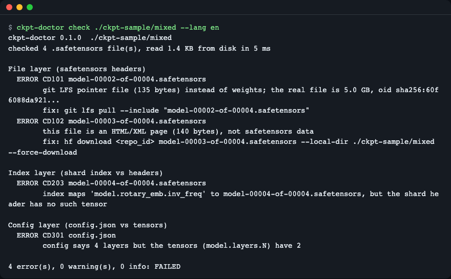
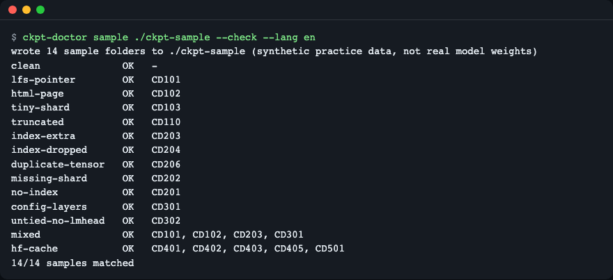
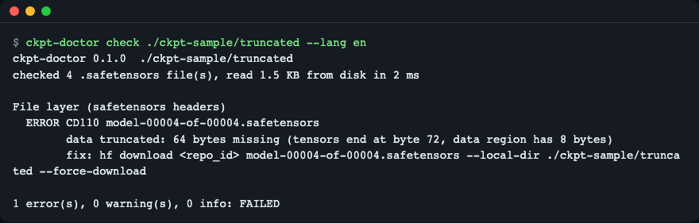
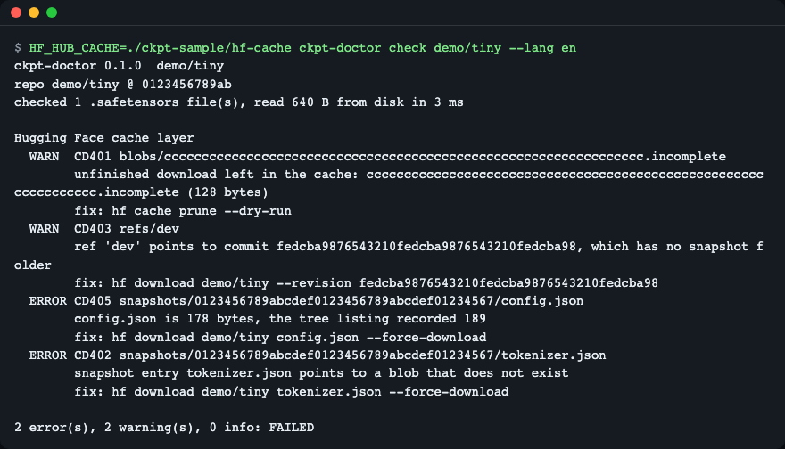
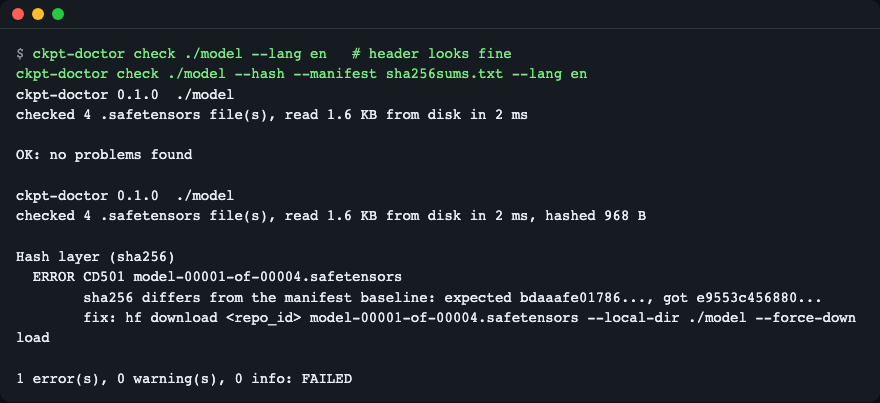
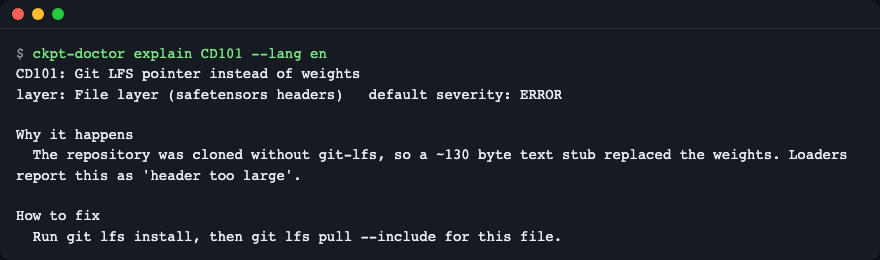
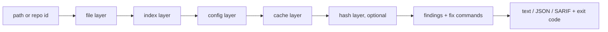

# ckpt-doctor

**English** | [한국어](README.ko.md)

Find out which `.safetensors` file in a model folder is broken, why, and the exact command that fixes it — by reading only the first few KB of each file. No torch, no `safetensors` package, no network, and the weights are never loaded into memory.


*One run on a broken sample folder: a Git LFS stub, an HTML page saved as weights, an index that disagrees with a shard, and a `config.json` that disagrees with the tensors — each with its own code.*

## Who it is for
- You downloaded or cloned a model and the loader says "header too large" or "incomplete metadata" after minutes of reading tens of GB.
- You publish fine-tuned checkpoints and want CI to reject a folder whose shards, `model.safetensors.index.json` and `config.json` do not agree.
- You keep a Hugging Face cache on a laptop or server and want to know whether a snapshot is intact (unfinished `.incomplete` blobs, broken symlinks) without going online.

## Why: the same error, different causes
A loader reports what it failed to parse, not why the file is wrong. Probed with `safetensors` 0.8.0 (2026-11-17):

| What is really wrong | What the loader says | ckpt-doctor code |
|---|---|---|
| Git LFS pointer (a ~130 byte text stub) | `header too large` | `CD101` |
| HTML error or login page saved as weights | `header too large` (same message) | `CD102` |
| Download stopped early | `incomplete metadata, file not fully covered` (older versions: `MetadataIncompleteBuffer`) | `CD110` |

Both stubs begin with text, and read as an 8-byte number that text is far above the 100 MB header limit, so the library cannot tell them apart. ckpt-doctor looks at the first bytes as text first, and detects truncation from byte offsets instead of matching a message that changes between versions.

## How safetensors files are laid out
```text
model-00001-of-00004.safetensors
[ u64 N (8 bytes, little endian) ][ N bytes of JSON header ][ data region: raw tensor bytes ]
                                    {"name": {"dtype": "F16", "shape": [..], "data_offsets": [begin, end]}, ...}
```
- The header lists every tensor with its dtype, shape and `data_offsets` (byte range inside the data region). The ranges must tile the region with no gap, overlap or extra bytes, so file size = 8 + N + end of the last tensor. That is why reading only the header is enough to detect most damage.
- A **shard** is one of several `.safetensors` files that together hold a large model.
- The **index** (`model.safetensors.index.json`) has a `weight_map` (tensor name -> shard file) and `metadata.total_size` (sum of tensor bytes, not file sizes). Loaders trust it to find each tensor.
- `config.json` states the architecture (layer count, tied embeddings, dtype) that the tensor names must match.
- The Hugging Face cache stores `models--org--name/refs/<branch>` (a commit id), `snapshots/<commit>/<file>` (symlinks) and `blobs/<hash>` (the real files; unfinished ones end in `.incomplete`).

## Install
```bash
curl -LsSf https://astral.sh/uv/install.sh | sh      # uv (skip if you have it); Python 3.10+
uv tool install git+https://github.com/LeeGyeongPil/ckpt-doctor
ckpt-doctor --version
```
Or run once without installing: `uvx --from git+https://github.com/LeeGyeongPil/ckpt-doctor ckpt-doctor --help`. The tool has no runtime dependencies (Python standard library only).

## Quick start
Make 14 small synthetic folders (1 healthy, 13 broken; practice data, not real weights) and check one. Run it in an empty folder, not inside a git checkout, so the practice files do not mix with your project:
```bash
cd "$(mktemp -d)"
ckpt-doctor sample ./ckpt-sample --check
ckpt-doctor check ./ckpt-sample/mixed
```

*`sample --check` builds the folders and verifies that every fault is detected with exactly the expected codes (`14/14 samples matched`).*

Reading the report of `check`:
- Findings are grouped by layer: file (safetensors headers), index, config, Hugging Face cache, hash.
- `ERROR` makes the exit code 1; `WARN` and `INFO` do not (unless `--strict`).
- `fix:` is a command you can paste. `<repo_id>` is a placeholder you fill in (or pass `--repo-id`).

## Usage
| Command / option | What it does | Example |
|---|---|---|
| `check PATH` | Check a model folder, one `.safetensors`, a `*.safetensors.index.json`, or a cached repo id | `ckpt-doctor check ./my-model` |
| `check org/name` | Check a Hugging Face cache entry (reads `HF_HUB_CACHE`, never the network) | `ckpt-doctor check demo/tiny` |
| `--revision REF` | Cache only: branch/ref or commit to check (default `main`) | `--revision dev` |
| `--cache-dir DIR` | Cache folder (default `HF_HUB_CACHE`, else `HF_HOME/hub`) | `--cache-dir ./hub` |
| `--repo-id ID` | Repo id to put into fix commands for a plain folder | `--repo-id org/name` |
| `--hash` | Also verify sha256 of every file (reads all bytes, slow on big models) | `check ./my-model --hash` |
| `--manifest FILE` / `--write-manifest FILE` | Baseline in `sha256sum` format to compare against / to write | `--write-manifest sha256sums.txt` |
| `--json` / `--sarif FILE` | Machine-readable report (schema in `docs/report.schema.json`) / SARIF 2.1.0 | `--sarif out.sarif` |
| `--strict` | Exit 1 on warnings too | `check ./my-model --strict` |
| `--lang en\|ko` | Output language (all commands) | `--lang ko` |
| `--no-color` | No color, same as `NO_COLOR=1` (`check` only; other commands print no color) | `check ./my-model --no-color` |
| `explain [CODE]` | Explain one finding code, or list all | `ckpt-doctor explain CD101` |
| `sample DIR [--check]` | Create practice folders, optionally verify them | `ckpt-doctor sample ./ckpt-sample` |

Exit codes: `0` no errors, `1` errors found (warnings too with `--strict`), `2` usage error such as a missing path.

### Scenario 1: a download stopped early
```bash
ckpt-doctor check ./ckpt-sample/truncated
```

*`CD110` says how many bytes are missing; only that one shard needs to be downloaded again.*

### Scenario 2: is my Hugging Face cache intact?
```bash
HF_HUB_CACHE=./ckpt-sample/hf-cache ckpt-doctor check demo/tiny
```

*Resolves `refs/main` to a snapshot offline, then reports the `.incomplete` blob, a ref without a snapshot, a size that differs from the recorded tree listing and a broken symlink.*

### Scenario 3: the header is fine but the data is corrupt
Headers alone cannot see a flipped byte in the data region. Record a baseline once, then verify later with `--hash`. `./model` stands for your own model folder; to practice, copy the healthy sample and flip one byte yourself (run this in the folder from the quick start):
```bash
cp -R ckpt-sample/clean model                                # practice copy (skip for your own model)
ckpt-doctor check ./model --write-manifest sha256sums.txt   # only when there are no errors
python3 -c "p='model/model-00001-of-00004.safetensors'; b=bytearray(open(p,'rb').read()); b[-1]^=1; open(p,'wb').write(b)"   # flip the last data byte
ckpt-doctor check ./model                                    # still OK: the header is unchanged
ckpt-doctor check ./model --hash --manifest sha256sums.txt   # CD501, exit code 1
```

*Without `--hash` the folder looks clean; with a baseline `CD501` names the file whose sha256 changed. With no manifest, `--hash` uses the sha256 in the Hub tree listing or the blob name when available.*

### Scenario 4: understand a code, use it in CI
```bash
ckpt-doctor explain CD101
ckpt-doctor check ./model --sarif ckpt.sarif --strict
```

*`explain` gives the cause and the fix for a code. All codes are listed in [docs/codes.md](docs/codes.md).*

Python API. The `uv tool install` above keeps the tool in its own environment, so install the package into the Python you import it from:
```bash
pip install git+https://github.com/LeeGyeongPil/ckpt-doctor   # or: uv add git+https://github.com/LeeGyeongPil/ckpt-doctor
```
```python
from ckpt_doctor import check_path

r = check_path("./ckpt-sample/truncated")
for f in r.findings:
    print(f.code, f.severity.value, f.message())   # message(lang="en") is a method
print(r.ok)
```

## CI usage
Exit codes: `0` no errors, `1` errors (also warnings with `--strict`), `2` usage error. Keep `--strict` in CI: without it, a folder that exists but has no `.safetensors` files (`CD001`, a warning; for example the wrong subfolder) passes with exit code `0`. A path that does not exist always fails with exit code `2`. `--sarif FILE` writes a SARIF 2.1.0 report that GitHub code scanning can show. A minimal job:
```yaml
name: model-check
on: [push, pull_request]
jobs:
  ckpt-doctor:
    runs-on: ubuntu-latest
    permissions:
      contents: read
      security-events: write
    steps:
      - uses: actions/checkout@v4
        with:
          lfs: true          # without this, weights are LFS pointer stubs (CD101)
      - run: pip install git+https://github.com/LeeGyeongPil/ckpt-doctor
      - run: ckpt-doctor check . --strict --sarif ckpt.sarif
      - if: always()
        uses: github/codeql-action/upload-sarif@v3
        with:
          sarif_file: ckpt.sarif
```
The workflow is an example and was not run on GitHub; the commands inside it were run locally (`check --strict --sarif`, exit code `1` on an LFS pointer folder).

## Configuration
| Variable | Meaning |
|---|---|
| `CKPT_DOCTOR_LANG` | `en` or `ko`. Precedence: `--lang` > `CKPT_DOCTOR_LANG` > `LC_ALL`/`LC_MESSAGES`/`LANG`; anything but Korean falls back to English |
| `HF_HUB_CACHE` | Hub cache folder used to resolve `org/name` (read only) |
| `HF_HOME` | Fallback: `<HF_HOME>/hub` |
| `NO_COLOR` | Turn colors off |

Finding codes and JSON keys do not depend on the language.

## How it works

- **File layer** reads the 8-byte length and the JSON header of each file and checks them against the file size: LFS pointer, HTML, truncation, holes, trailing bytes.
- **Index layer** compares `model.safetensors.index.json` with the shard headers: missing shards, tensors in the wrong or two shards, `total_size`.
- **Config layer** compares `config.json` with tensor names: layer count, tied embeddings, dtype.
- **Cache layer** checks the Hugging Face cache layout (`refs`, `snapshots`, `blobs`) and sizes from the tree listing, offline.
- **Hash layer** (only with `--hash`) reads whole files and compares sha256.

A sparse 2 GiB file with a valid header is checked while reading under 1 MiB (covered by the tests).

## When to use it
- Good fit: finding out which shard of a safetensors model folder or Hugging Face cache snapshot is broken and why, before spending minutes loading it, and gating a model repo in CI.
- It does not load models, check numerical values, or repair files. It only reads and tells you the command.

## Limits
- Values are not checked: NaN, a flipped byte inside a tensor, or wrong weights with a valid layout pass the header checks. `--hash` against a baseline catches changed bytes, but a matching sha256 only proves the file equals the baseline, not that the model is the authentic one.
- Layer-count checks know only a few naming schemes (`model.layers.N`, `encoder.layer.N`, `transformer.h.N`, `h.N` (GPT-2), `blocks.N`, `layers.N`); other names give `CD390` (info) instead of a guess.
- The sample folders are synthetic. Real folders were not verified in this repository's tests beyond the cross-check with `safetensors` 0.8.0.
- Only `.safetensors` is read (no `.bin`, `.gguf`, `.pt`).

## Alternatives & credits
- [`hf cache verify`](https://huggingface.co/docs/huggingface_hub/guides/cli) re-verifies a cache against the Hub (needs Hub access); ckpt-doctor works offline and also checks index and config.
- The official [safetensors](https://github.com/huggingface/safetensors) library opens one file and is the reference for the format; ckpt-doctor reimplements only the header checks and cross-checks against it in tests.
- [TengRrui/shardcheck](https://github.com/TengRrui/shardcheck) is another header/index checker, so it overlaps with the file and index layers here. See its README for what it covers.

## Troubleshooting
| Symptom | Cause | Fix |
|---|---|---|
| `CD001` no .safetensors files | Folder holds `.bin`/`.gguf` weights or is the wrong folder | Point at the folder with `.safetensors` files |
| `path not found`, exit 2 | Path typo, or the repo id is not in the cache | Check the path; set `HF_HUB_CACHE` or `--cache-dir` |
| Fix shows `<repo_id>` | A plain folder has no repo id | Add `--repo-id org/name` |
| `check --hash` is slow | It reads every byte | Use it only for the final check; plain `check` reads headers only |
| Output in Korean | Your locale is Korean | `--lang en` or `CKPT_DOCTOR_LANG=en` |

## Development
```bash
uv run pytest -q
uv run --group crosscheck pytest -q tests/test_crosscheck.py   # compares with safetensors 0.8.0
```
Bugs and suggestions are welcome as issues. Changes are in [CHANGELOG.md](CHANGELOG.md).

## License
MIT. The sample folders are synthetic and contain no real model data.
